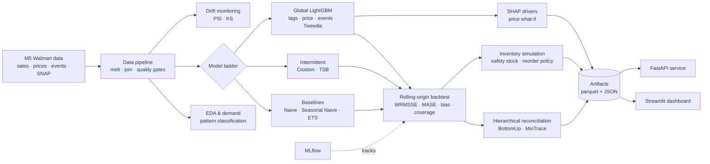

# 📦 DemandSense: Retail Demand Forecasting & Inventory Optimisation

**Forecast daily demand for every item in every store, 28 days ahead, and turn it into ordering decisions that cut inventory cost and empty shelves.**

[](.github/workflows/ci.yml)


**[▶ Live dashboard](https://YOUR-APP.streamlit.app)** · [Model card](docs/model_card.md) · [EDA notebook](notebooks/01_eda.ipynb) · [Deployment guide](docs/deployment.md)

<a href="https://YOUR-APP.streamlit.app">
  
</a>

---

## The business problem

A grocery retailer decides **every week how much of each product to order for each store**. Order too
little and shelves go empty (lost sales and customers). Order too much and cash is tied up in stock that sits
or spoils. Most stores still plan with simple rules such as *"order what sold the same day last week"*.

DemandSense answers two questions a client would ask:

1. **How accurately can we forecast demand** for thousands of item-store combinations, including slow movers
   that sell nothing most days?
2. **What is that accuracy worth?** How much higher is the fill rate, and how much lower is the inventory
   cost, if we order using these forecasts?

## Results

<!-- RESULTS:START -->
> ⚠️ **These numbers come from the bundled synthetic sample (M5 format), not real Walmart data.** They demonstrate the system end to end. Run on the real M5 data to replace them.

*480 item × store series · 3 × 28-day rolling backtest · generated 2026-11-20 11:08:00*

| Headline | Result |
|---|---|
| Forecast error vs current method (SeasonalNaive) | **30% lower** WRMSSE (0.738 vs 1.047) |
| Inventory needed for the same 98.5% fill rate | **-17%** ($13,591 working capital freed) |
| Fill rate with the same inventory | 98.5% → **99.3%** |
| Lost margin with the same inventory | **-53%** |
| Hierarchy coherence (total vs sum of items) | 7.2% gap → **0%** after reconciliation |
| 80% prediction-interval coverage (LightGBM, conformal) | 78.2% |

**Backtest leaderboard** (lower is better; WRMSSE < 1 beats a naive forecast)

| Model | WRMSSE | MASE | Bias |
|---|---:|---:|---:|
| **LightGBM** | 0.738 | 0.757 | -0.1% |
| AutoETS | 0.738 | 0.758 | +4.1% |
| HistoricAverage | 0.751 | 0.776 | +0.3% |
| CrostonOptimized | 0.765 | 0.776 | +7.9% |
| TSB | 0.788 | 0.795 | +9.4% |
| Naive | 0.988 | 0.915 | -8.9% |
| SeasonalNaive | 1.047 | 0.975 | +7.5% |

**Reconciliation** (RMSSE by level, 28-day holdout)

| Level | Base (no reconciliation) | BottomUp | MinTrace (mint_shrink) | MinTrace (wls_struct) |
|---|---:|---:|---:|---:|
| Total (state) | 0.777 | 0.599 | 0.640 | 0.666 |
| Store | 0.727 | 0.683 | 0.699 | 0.714 |
| Department | 0.742 | 0.644 | 0.664 | 0.683 |
| Store x Dept | 0.717 | 0.724 | 0.728 | 0.737 |
| Item x Store | 0.681 | 0.681 | 0.681 | 0.685 |
<!-- RESULTS:END -->

## Dashboard tour

**Forecast explorer:** pick any store, department and item to see actual sales, how each model did in the backtest (the dashed lines mark each cutoff), and the next 28 days with 80% / 95% prediction intervals.


**Inventory impact:** every model simulated across service targets from 50% to 99.5%. A curve further up and to the left means the same fill rate with less stock.


**Model accuracy:** rolling-origin backtest leaderboard, error by demand pattern, and how well the prediction intervals are calibrated.


The live app also has **Hierarchy** (reconciliation across levels), **Demand drivers** (SHAP + price what-if), **Data & monitoring** (quality checks, drift) and **Methodology** tabs.

## How it works



| Stage | What happens | Why it matters |
|---|---|---|
| **Data** | M5 wide → long, join prices/calendar, drop pre-launch days, quality gates | Pre-launch zeros are "not on shelf", not "no demand" |
| **EDA** | Seasonality, event / SNAP / promo lift, Syntetos-Boylan demand classes | Every finding maps to a modelling choice |
| **Models** | Naive, SeasonalNaive, HistoricAverage, AutoETS, Croston, TSB, global LightGBM (NHITS optional) | Complex models must beat simple baselines |
| **Validation** | 3 × 28-day rolling-origin backtest, refit at each cutoff | Honest, leakage-free estimate of live accuracy |
| **Metrics** | WRMSSE (official M5), MASE, RMSSE, bias, interval coverage, pinball loss | Scale-free, zero-safe, revenue-weighted |
| **Hierarchy** | Item → store × dept → store / dept → state, reconciled with MinTrace | Plans add up across finance, logistics and category teams |
| **Decisions** | Periodic-review order-up-to policy simulated against real demand | Translates accuracy into fill rate and money |
| **Explainability** | SHAP feature importance, price what-if | Builds trust with planners |
| **MLOps** | Config-driven pipeline, MLflow, FastAPI, Docker, pytest, CI, weekly retrain, drift checks | Runs every week, not once |

## Quick start

```powershell
git clone https://github.com/YOUR-USERNAME/demandsense.git
cd demandsense
py -3.11 -m venv .venv
.\.venv\Scripts\Activate.ps1
pip install -r requirements.txt
```

**1. Get the data.** Real M5 data (free Kaggle account needed, see [`scripts/download_data.py`](scripts/download_data.py)):

```powershell
python scripts/download_data.py
```

No Kaggle account yet? Skip this step. The pipeline then generates a synthetic sample in the exact M5 format,
and every output is labelled `synthetic`.

**2. Run the pipeline** (about 5-15 minutes on a laptop):

```powershell
python scripts/run_pipeline.py --export-demo
```

**3. Explore**

```powershell
streamlit run app/streamlit_app.py        # dashboard  -> http://localhost:8501
uvicorn api.main:app --reload             # API        -> http://127.0.0.1:8000/docs
mlflow ui --backend-store-uri sqlite:///mlflow.db   # experiment history -> http://127.0.0.1:5000
pytest                                    # tests (includes an end-to-end pipeline run)
```

## Project structure

```
demandsense/
├── configs/config.yaml          # every tunable choice: data subset, models, backtest, inventory policy
├── src/demandsense/
│   ├── data/                    # load.py (M5 → tidy), quality.py (gates), synthetic.py (M5-format sample)
│   ├── features.py              # exogenous features, Syntetos-Boylan demand classes
│   ├── models/                  # statistical.py, ml.py (LightGBM), neural.py (NHITS, optional)
│   ├── evaluation/metrics.py    # WRMSSE, MASE, RMSSE, bias, pinball, coverage
│   ├── hierarchy.py             # aggregation + BottomUp / MinTrace reconciliation
│   ├── inventory.py             # (R, S) policy simulation and business impact
│   ├── explain.py               # SHAP + price what-if
│   ├── monitoring.py            # PSI / KS drift (+ optional Evidently report)
│   ├── tracking.py              # MLflow logging
│   └── pipeline.py              # orchestrates everything, writes artifacts
├── api/main.py                  # FastAPI forecast service
├── app/streamlit_app.py         # dashboard (reads app/demo_artifacts when hosted)
├── notebooks/01_eda.ipynb       # exploratory analysis → modelling decisions
├── scripts/                     # run_pipeline.py, download_data.py, take_screenshots.py, update_readme.py
├── tests/                       # unit + end-to-end tests
├── docs/                        # interview notes, model card, deck outline, deployment guide
├── Dockerfile                   # API container
└── .github/workflows/           # CI + weekly retraining
```

## API example

```bash
curl http://127.0.0.1:8000/forecast/FOODS_2_040_CA_1
```

Response from the bundled synthetic run (truncated to 2 of 28 days):

```json
{
  "unique_id": "FOODS_2_040_CA_1",
  "model": "LightGBM",
  "data_source": "synthetic",
  "horizon_days": 28,
  "total_units": 978.76,
  "points": [
    {"date": "2014-05-13", "forecast": 31.241, "lo_80": 0.0, "hi_80": 88.174, "lo_95": 0.0, "hi_95": 157.789},
    {"date": "2014-05-14", "forecast": 28.657, "lo_80": 0.0, "hi_80": 85.59, "lo_95": 0.0, "hi_95": 155.205}
  ]
}
```

## Key design decisions

- **Global model over per-item models:** slow movers lack history on their own; one model learns shared patterns across thousands of series.
- **Tweedie objective:** sales are non-negative, zero-inflated and right-skewed.
- **Monotonic constraints:** demand can only fall when price rises and only rise when the discount deepens, so the price what-if never shows a promotion "losing" volume.
- **No MAPE:** undefined with zero sales; WRMSSE weights accuracy by revenue.
- **Leakage controls:** refit per cutoff, recursive lag features, discount depth vs *past* max price, safety stock calibrated on an earlier window than it is evaluated on.
- **Batch scoring:** forecasts are produced on a schedule and served from storage, which is cheap, fast and auditable.

## Limitations and next steps

- Future promotions are assumed unknown unless supplied; plug in the promotions calendar for production.
- Inventory simulation assumes lost sales, fixed lead time and 25%/year holding cost; refine with real margins, shelf life and case packs.
- Next: weather and local events, Optuna tuning inside the backtest, ETS + LightGBM ensemble, full-distribution inventory optimisation.

## Data

M5 Forecasting dataset (Walmart), [Kaggle competition](https://www.kaggle.com/competitions/m5-forecasting-accuracy).
Raw data is not redistributed in this repository. The hosted dashboard only contains aggregated model outputs.

## License

MIT
